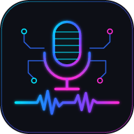
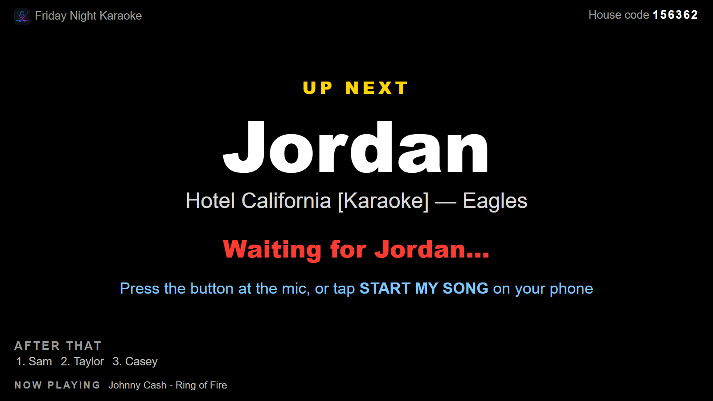
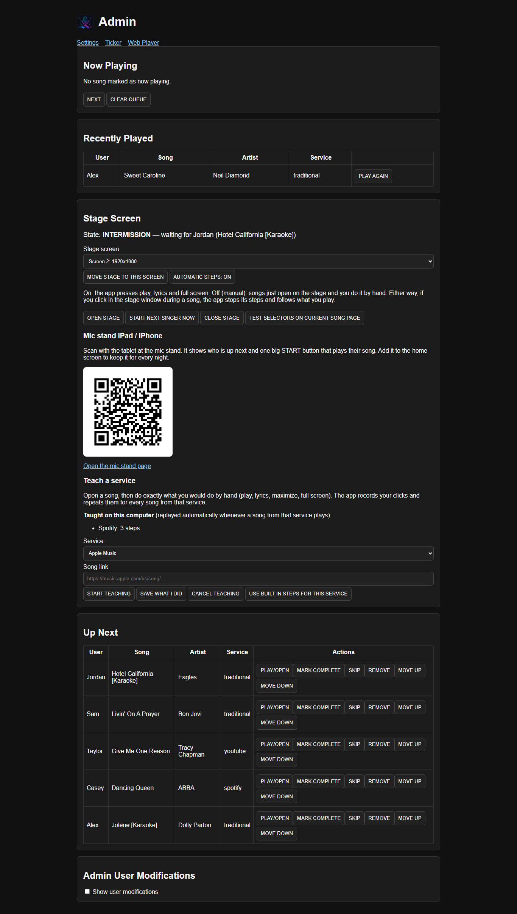
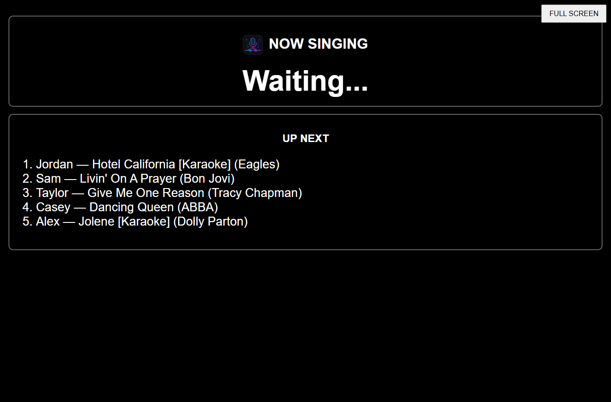
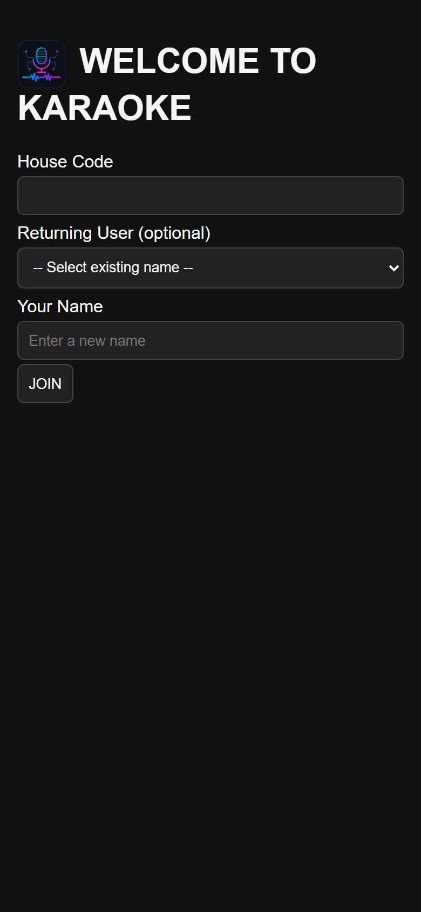
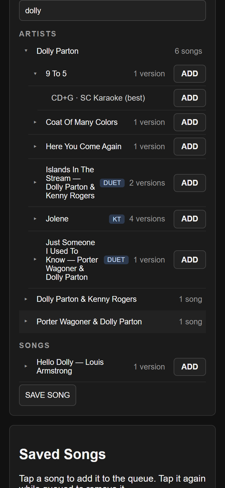
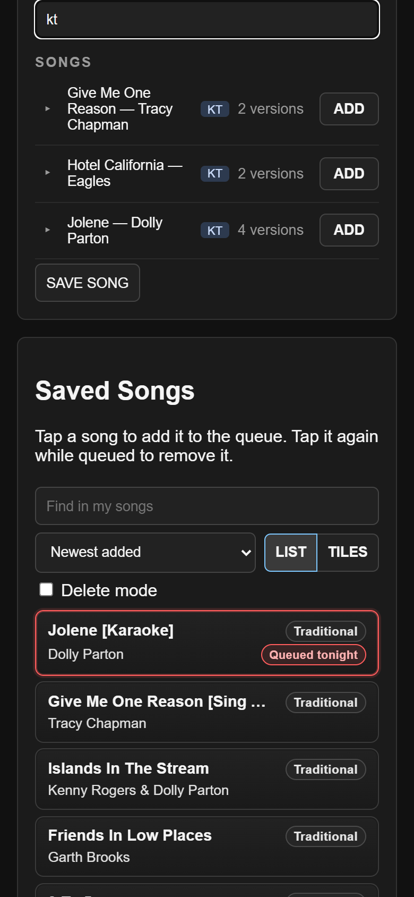
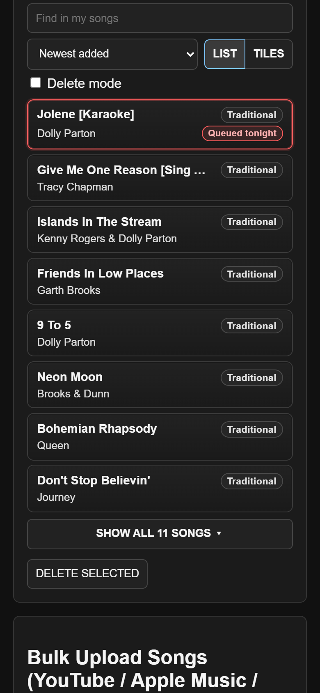
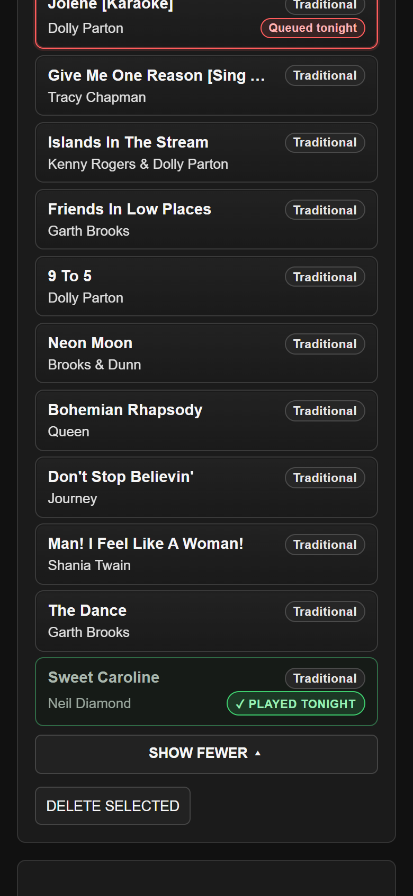
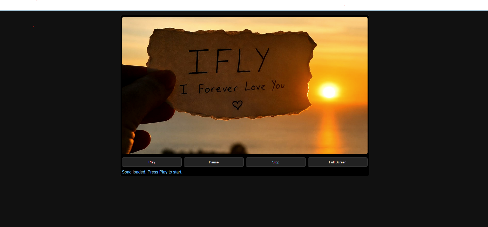

<p align="center"></p>

# Karaoke Ticker

**Karaoke Ticker doesn't just manage the karaoke queue. It runs the karaoke show.**

Click **START HOUSE** and the rest runs itself. The stage screen opens on your TV with break music playing. Guests join from their phones and pick songs. Each singer is called up in a fair rotation, starts their own song from their phone or a button at the mic, and the song plays fullscreen with lyrics. When it ends, the next singer is called.

It plays YouTube, YouTube Music, Spotify, Apple Music and your own traditional karaoke (MP3+CDG and video) library, all on one Windows PC.

**[Download the latest KaraokeTicker.exe](https://github.com/practicinglife/Karaoke/releases/latest/download/KaraokeTicker.exe)** · [All releases](https://github.com/practicinglife/Karaoke/releases)

## ✨ Fully Automated Stage

- **One click to start:** START HOUSE opens the stage screen on the TV, with the intermission screen and break music, ready for the first singer.
- **Hands-free playback:** the app opens each song, presses play, opens the lyrics and goes full screen. It plays the exact track, not the whole album, skips YouTube ads where it can, and keeps the video fullscreen.
- **Knows when a song is over:** it notices the song ending (or the service moving on to another track) and calls the next singer.
- **Intermission between singers:** who's up next, their song, a countdown, the singers after them, and shuffled break music from your own folder.
- **The singer starts their own song:** START MY SONG on their phone, a mic-stand iPad, a foot pedal, or a network button. If they don't show, the countdown can start the song anyway or move them down one.
- **Fair singer rotation:** everyone gets a turn before anyone sings twice.
- **Never stuck:** you can take over any song by hand, switch to manual mode, or teach the app new steps when a music site changes its buttons.

## How a Karaoke Night Works

**You:** click **START HOUSE** in the desktop app. That's the only required step.

**Then it runs itself:**

1. The stage screen opens fullscreen on the TV with the intermission screen, and the break music starts.
2. Guests scan the join QR code (**SHOW QR CODE**; print it or put it on the tables) and join with the house code.
3. Guests save songs from YouTube, YouTube Music, Spotify, Apple Music or the karaoke library, and tap one to queue it.
4. The intermission screen calls the first singer, with a countdown. Their phone flashes **UP NEXT!!** and shows **START MY SONG**.
5. The singer steps up and presses **START MY SONG** on their phone, or **START** on the mic-stand iPad, or the foot pedal. The break music fades out.
6. Their song plays fullscreen with lyrics.
7. When it ends, it's marked done and the intermission screen calls the next singer.
8. Repeat until you click **STOP HOUSE**.

Want zero touches at all? In Settings, set *When the countdown runs out* to **Start their song anyway**.

## Screenshots

*(Demo singers and songs.)*

### Stage screen: between singers
Who's up next and their song, the countdown, the singers after them, and the break song that's playing.



### Admin dashboard
Now playing, recently played, the stage screen controls, the mic-stand QR code, teach mode and the queue.



### Live queue ticker


### Guests' phones
<table>
  <tr>
    <td align="center"><br>Join with the house code</td>
    <td align="center"><br>Search: artist → songs → versions</td>
    <td align="center"><br><b>kt</b>: your [KT Karaoke] / [KT Sing Along] videos</td>
  </tr>
  <tr>
    <td align="center"><br>Saved songs: find, sort, queued first</td>
    <td align="center"><br>Sung tonight drops to the bottom</td>
    <td></td>
  </tr>
</table>

### Player fullscreen


## Guest Experience

Guests use their own phones on the same Wi-Fi. There's nothing to install.

1. Scan the QR code or open the join link, and enter the house code.
2. Pick a new name, or choose their saved name from an earlier night.
3. On their page they can:
   - save songs to their own list: search the karaoke library, or paste YouTube, YouTube Music, Spotify or Apple Music links (or bulk-paste many at once)
   - search by typing an artist or a title: results are grouped by **artist → songs → versions** (Karaoke and Sing Along videos, other videos, CD+G discs by brand), with one-tap **ADD**. Spellings of the same song are merged, and duets show under each singer. Type **duets**, **kids** or **kt** (videos named [KT Karaoke] / [KT Sing Along]) to list those, or add a name to narrow it ("kt eagles")
   - find their own saved songs fast: a compact list with **Find in my songs**, sorting, songs queued tonight first and songs **already sung tonight** at the bottom
   - tap a saved song to queue it, and tap it again to take it back out
   - get flashing **UP NEXT!!** and **UP NOW!!** alerts (with vibration) when their turn comes
   - press **START MY SONG** when they're at the mic

Singers and their saved songs are kept from night to night.

## Stage Automation

The stage screen is a dedicated Microsoft Edge window that the app controls, fullscreen on the screen you choose. It reuses one tab, so songs never pile up as new tabs.

### What the app does for each service

| Service | Automatic steps |
|---|---|
| YouTube | waits for playback, presses play if needed, video fullscreen, skips ads it can |
| YouTube Music | plays, opens the Lyrics tab, fullscreen player |
| Spotify | plays if needed, opens the lyrics, full screen |
| Apple Music | plays the highlighted track (not the whole album), opens Lyrics, then lyrics full screen |
| Traditional karaoke | built-in CDG/video player: play and fullscreen |

During a song the app keeps the stage window fullscreen, puts a video back into fullscreen if it drops out, and blocks popups such as "Open Spotify?" and "Translate this page?".

### Ready buttons: who starts the next song

Any of these starts the song of whoever is up next:

- **Singer's phone:** a big **START MY SONG** button appears on the singer's page when it's their turn. It only works for that singer.
- **Mic-stand iPad/iPhone:** scan **SHOW MIC STAND QR** in the desktop app, or the QR code on the admin page, then use Share → *Add to Home Screen*. It shows who's up, the countdown and one big **START** button, keeps the screen awake, and keeps working every night.
- **Foot pedal, presenter clicker or Bluetooth remote:** any button that types the *Ready button key* from Settings (default `F9`). It works no matter which window is in front.
- **Network button** (Flic, ESP32, smart button): have it open the *Network ready button URL* shown in Settings.
- **Host:** **START NEXT SINGER NOW** or **PLAY/OPEN** on the admin page.

### When the countdown runs out

You choose in Settings: keep waiting (default), start their song anyway, or move them down one and call the next singer.

### Teach mode

When a music site changes its buttons, or you want it done differently, show the app once:

1. Admin page → Stage card → **Teach a service**: pick the service and paste a song link.
2. Click **START TEACHING**, and do exactly what you'd do by hand (for example Spotify: *Show more*, then *Enter full screen*).
3. Click **SAVE WHAT I DID**. Every song from that service now follows those steps.

**USE BUILT-IN STEPS FOR THIS SERVICE** undoes it. **TEST SELECTORS ON CURRENT SONG PAGE** shows which buttons the app can find on the song that's playing.

## Manual Control

The automation never locks you out:

- **Take over one song:** click or type in the stage window while a song is playing. The app stops its own steps for that song and follows what you play, so switching tracks by hand isn't treated as the song ending. The admin page says *You took over this song*.
- **Manual mode for the night:** switch **AUTOMATIC STEPS** to **OFF (MANUAL)** on the admin page. Songs still open on the stage, and you press play, lyrics and full screen. The app still notices the end of each song and calls the next singer.
- **NEXT** ends the current song and calls the next singer. **PLAY AGAIN** (Recently Played) replays a song that was cut short.

## Singer Rotation

With **Singer Rotation** on (the default), the queue runs in rounds: each singer gets one song per round, in the order they joined the queue. Nobody is called twice in a row while others are waiting, however many songs they queue. Turn it off for plain first-come, first-served. The admin page can still move any song up or down, skip it or remove it.

## Supported Song Sources

- **YouTube** and **YouTube Music**: any video or song link. YouTube Premium avoids ads.
- **Spotify**: song links (Spotify Premium).
- **Apple Music**: song or album-track links (Apple Music subscription). The app plays exactly that track.
- **Traditional karaoke**: your MP3+CDG and video files (`.mp4 .mkv .avi .wmv`), indexed and searchable from guests' phones. They play in the built-in player on the stage screen, which is all most nights need. Optionally they can open in an external player instead: Kanto (which loads MP3+CDG directly) is the one that's been tested; other players haven't been.

The stage window signs in to your streaming services once and remembers it.

## Host Controls

**Desktop app:** START HOUSE / STOP HOUSE, OPEN STAGE / CLOSE STAGE, the QR codes (guest join, kiosk, ticker, mic stand), OPEN ADMIN / KIOSK / TICKER, REFRESH KARAOKE LIBRARY, BACKUP USER DATA / IMPORT USER DATA, SETTINGS.

**Admin page** (any browser on the network, updates live):
- Now Playing, NEXT, and the queue with play, skip, remove, and move up/down
- Recently Played with PLAY AGAIN
- Stage card: stage status, choose the screen, AUTOMATIC STEPS on/off, START NEXT SINGER NOW, Teach mode, TEST SELECTORS, and the mic-stand QR code
- Settings: house name, karaoke folder, port, rotation, stage screen, break-music folder, countdown, ready key

**Ticker page:** an optional now-singing / up-next display for a second screen.

## Installation

1. Download **[KaraokeTicker.exe](https://github.com/practicinglife/Karaoke/releases/latest/download/KaraokeTicker.exe)** and run it. It needs Windows 10/11 with Microsoft Edge (built in).
2. **First-time setup:**
   1. In the desktop app, open **SETTINGS** and set your **Karaoke Folder**, then click **REFRESH KARAOKE LIBRARY**.
   2. Click **START HOUSE**, open the admin page, and go to **Settings**. Under *Stage Screen*, pick the TV, your break-music folder, the countdown and the ready key.
   3. In the stage window, press **F11**, sign in to Apple Music, Spotify and YouTube once, then click **MOVE STAGE TO THIS SCREEN** on the admin page to put it back fullscreen.
   4. Optional: scan **SHOW MIC STAND QR** with the iPad at the mic stand.
3. From then on, every night is just **START HOUSE**.

`KaraokeTicker.exe --self-test` checks that the stage screen works on a computer and writes a report to `%TEMP%\karaoke-ticker-selftest.json`.

### Is the download safe?

- Every [release](https://github.com/practicinglife/Karaoke/releases) lists the exe's SHA-256 and links its VirusTotal scan. Check that your download matches:
  ```bat
  certutil -hashfile KaraokeTicker.exe SHA256
  ```
- The exe is built from this repository with `build.bat`, also on GitHub's servers by the [build workflow](.github/workflows/build.yml) for every change. To keep antivirus false alarms down, the build compiles its own launcher instead of PyInstaller's shared prebuilt one.
- The exe isn't code-signed yet, so Windows SmartScreen may say *"Windows protected your PC"* the first time. Click **More info → Run anyway**. See the [Code signing policy](#code-signing-policy).

### Uninstalling

Karaoke Ticker doesn't install anything into Windows. To remove it:

1. Click **EXIT** in the app.
2. Optional: click **BACKUP USER DATA** first and keep the backup if you may want your singers and songs again.
3. Delete `KaraokeTicker.exe` and the folder `%LOCALAPPDATA%\KaraokeTicker` (paste that into the File Explorer address bar).

### Your data and backups

The installed app keeps everything in `%LOCALAPPDATA%\KaraokeTicker\data`: singers, saved songs, history, settings, the music index, the stage window's sign-ins and taught steps.

- **BACKUP USER DATA** saves a dated backup (a full database copy, plus singers and songs as `users_and_songs.json`) under `data\backups\`.
- **IMPORT USER DATA** brings singers and songs into another copy of the app. It only adds what's missing and never deletes.
- Upgrades that change the database save a backup first (`data\backups\pre-cleanup-<date>.db`).

### Troubleshooting

- **Guests can't connect:** same Wi-Fi? Allow the app through the Windows firewall; the port is in Settings (default 8585).
- **Stage on the wrong screen:** pick the TV on the admin page and click **MOVE STAGE TO THIS SCREEN**.
- **Only a 30-second preview plays:** the stage window isn't signed in to that service. Sign in, then **PLAY AGAIN**.
- **Lyrics or full screen don't happen:** run **TEST SELECTORS ON CURRENT SONG PAGE**, or teach that service its steps.
- **No break music:** Settings shows whether the folder is set and how many songs it found.
- **Library search finds nothing:** set the Karaoke Folder and click **REFRESH KARAOKE LIBRARY**. The status shows how many songs are indexed.

More in [TROUBLESHOOTING.md](TROUBLESHOOTING.md) and [CONFIGURATION.md](CONFIGURATION.md).

## Advanced / Developer Setup

Run from source (Python 3.11+):

```bat
run.bat
```

`run.bat` creates `.venv`, installs `requirements.txt` and starts the desktop app (`main.py`). From source, the data lives in the project's `data\` folder instead of `%LOCALAPPDATA%`. `app.py` runs only the web server.

Tests:

```bat
.venv\Scripts\python.exe -m pytest -q
```

Build the Windows executable:

```bat
build.bat
```

The build bundles Playwright's driver, so the stage screen works from the .exe using the installed Edge. It then runs `--self-test` on the result and fails if the stage screen doesn't work. It never bundles the `data` folder, which holds your database and sign-ins.

Environment variables: `KARAOKE_TICKER_PORT`, `KARAOKE_TICKER_SECRET`.

Project layout:

```text
app.py          Flask + Socket.IO app factory and server entry
main.py         Desktop app entry (also: --self-test)
gui.py          Desktop host interface
config.py       Runtime defaults and data paths
karaoke/        Database models, queue and rotation, library indexing, backup/import
stage/          Stage screen: Edge control, song-end detection, per-service steps
                (selectors.json), Teach mode, ready hotkey, self-test
web/            Flask routes, templates and static assets (guest, admin, stage,
                mic-stand, ticker, kiosk, player)
tests/          Automated tests
```

## Architecture

- **Desktop app** (CustomTkinter): host controls; starts the embedded web server.
- **Web server** (Flask + Socket.IO): guest, admin, stage, mic-stand, ticker and player pages, with live updates.
- **Database** (SQLite, WAL mode): singers, saved songs, sessions, the queue, settings and the library index.
- **Stage controller** (Playwright): drives a normal Microsoft Edge window over its DevTools port. It loads songs, runs each service's steps, watches the page's own media player for the end of the song, and runs the intermission/ready cycle.

More in [ARCHITECTURE.md](ARCHITECTURE.md).

## Code signing policy

Free code signing provided by [SignPath.io](https://about.signpath.io), certificate by [SignPath Foundation](https://signpath.org). *(The application is under review; until it is approved, releases are unsigned.)*

- Every release exe is built from this repository by the [build workflow](.github/workflows/build.yml) on GitHub Actions.
- **Committers and reviewers:** [practicinglife](https://github.com/practicinglife)
- **Approvers:** [practicinglife](https://github.com/practicinglife) approves each release before it is signed.
- **Privacy:** see [Privacy](#privacy).

## Privacy

This program will not transfer any information to other networked systems unless specifically requested by the user or the person installing or operating it.

- Guests' phones talk only to the Karaoke Ticker computer on your own network.
- Music services (YouTube, YouTube Music, Spotify, Apple Music) are contacted only when you add or play their songs, in the stage browser window where you sign in yourself. Their own privacy policies apply.
- Singers, songs and settings stay on the computer in `%LOCALAPPDATA%\KaraokeTicker`.

## Contributing

Issues and pull requests are welcome. Work on a branch, run the tests, and open a pull request against `main`. When a music site changes its buttons, the fix is usually a small edit to `stage/selectors.json`.

## License

MIT. See [LICENSE](LICENSE).
