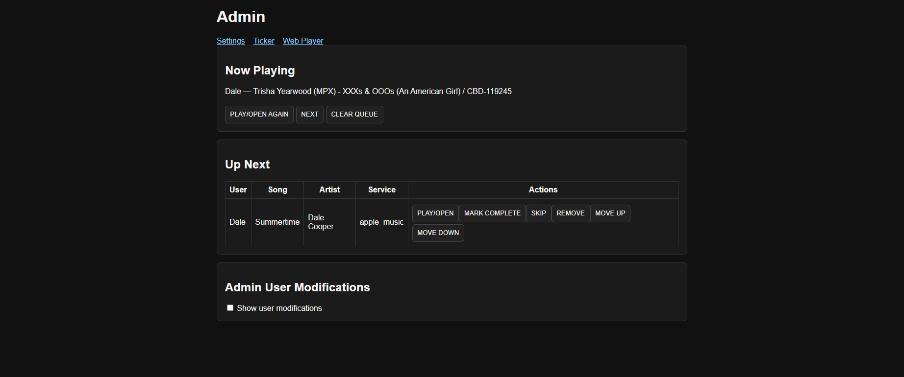
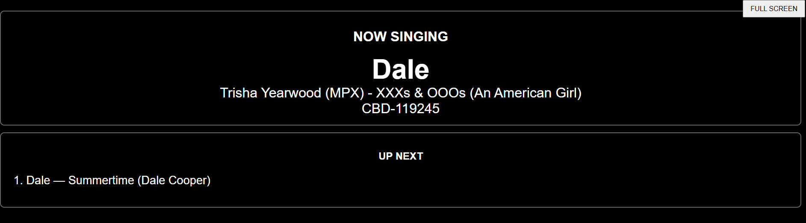
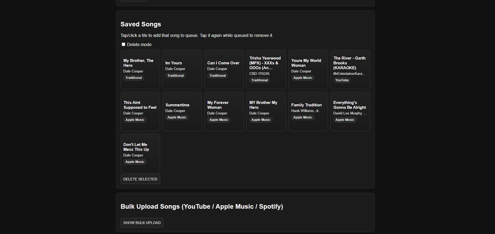
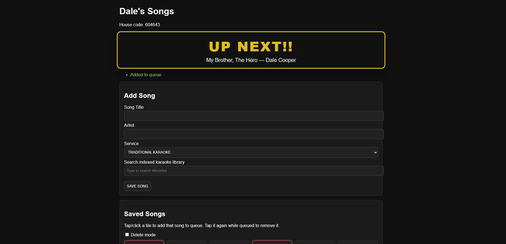
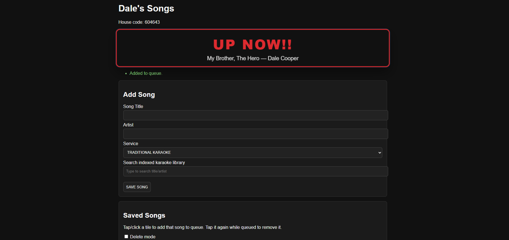
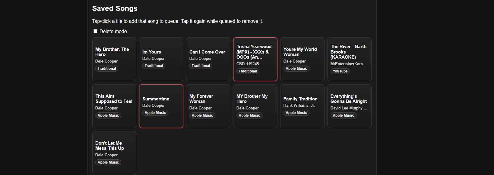
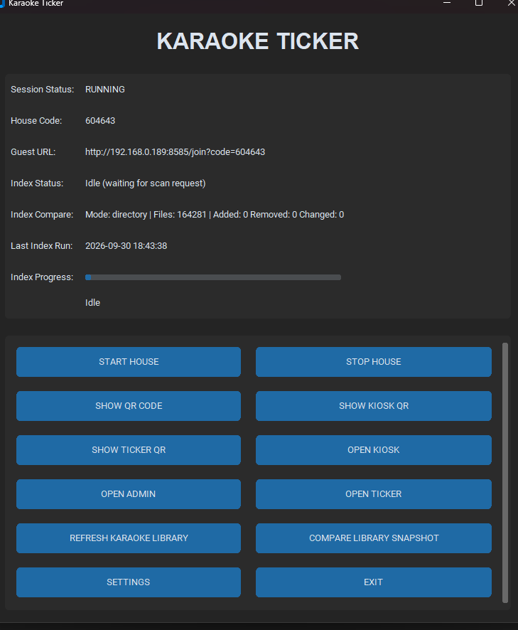

# Karaoke Ticker

Karaoke Ticker is a complete karaoke application.

It is a Windows-first karaoke host application built with CustomTkinter, Flask, Flask-SocketIO, and SQLite. It provides a local operator GUI, phone-friendly guest pages, live admin and ticker views, indexed traditional karaoke search, and browser-based queue updates.

Songs play on a **stage screen**: a dedicated Microsoft Edge window on your TV that plays YouTube, YouTube Music, Spotify, Apple Music and traditional karaoke fullscreen, then shows an intermission screen until the next singer presses **ready**. The app can press play, lyrics and full screen for you (automatic steps), or you can run each song by hand (manual mode). See [Stage Screen](#stage-screen).

External applications are optional.

## What the App Does

Karaoke Ticker manages a karaoke night with:

- persistent singers
- persistent saved songs per singer
- queue management with live updates
- indexed traditional karaoke library search
- YouTube, YouTube Music, Spotify and Apple Music link support
- a stage screen on the TV that plays each song fullscreen and detects when it ends
- an intermission screen between singers: next singer, countdown and break music
- several ways for the next singer to start their song: their phone, a mic-stand iPad/iPhone, a foot pedal or clicker, or a network button
- automatic steps (play, lyrics, full screen) per service, Teach mode to record your own, and a manual mode
- QR-code join flow for guests on the same network
- admin, kiosk, ticker, mic-stand and player web pages
- optional Kanto launch for local karaoke files
- in-page guest notifications such as **UP NEXT!!** and **UP NOW!!**
- backup and import of singers and saved songs

## Screenshots

### Admin


### Ticker / Live Queue


### User Bulk Upload


### Up Next / Singing Now



### Add to Queue


### House Session Join


### Player Fullscreen


## Current Runtime Model

The application has two main entry modes:

- `main.py` launches the desktop operator GUI
- `app.py` can run the Flask/Socket.IO server directly

For normal use, start the desktop GUI. It handles house/session control and opens the web surfaces used by guests and the host.

## Requirements

### Operating system

- Windows 10 or Windows 11 recommended

### Software

- Python 3.11 or newer (not needed for the packaged `KaraokeTicker.exe`)
- Microsoft Edge (installed with Windows 10/11): the stage screen runs in it
- A modern desktop browser for admin, ticker, kiosk, and player pages
- Subscriptions you want to sing from (Apple Music, Spotify Premium, YouTube Premium avoids ads)
- Optional: external media application executable (for example Kanto, VLC, mpv, Kodi, IINA) if you choose External Application playback mode

### Python dependencies

Installed from `requirements.txt`:

- Flask
- Flask-SocketIO
- SQLAlchemy
- customtkinter
- qrcode
- Pillow
- rapidfuzz
- playwright (controls the stage screen's Edge window; no browser download needed)
- keyboard (mic-stand button hotkey)
- pytest
- pyinstaller

## Project Layout

```text
Karaoke-copilot-karaoke-ticker-app/
├── app.py                  # Flask + Socket.IO app factory and server entry
├── main.py                 # Desktop GUI entrypoint
├── gui.py                  # Operator desktop interface
├── config.py               # Runtime defaults and paths
├── requirements.txt        # Python dependencies
├── run.bat                 # Bootstrap venv, install deps, start GUI
├── build.bat               # Build Windows executable
├── karaoke/                # Core app logic, models, services, indexing, launchers
├── stage/                  # Stage screen: Edge control, per-service steps (selectors.json), Teach mode
├── web/                    # Flask routes, templates, static assets
├── tests/                  # Automated test suite
├── data/                   # SQLite database and generated app data
└── logs/                   # Application logs
```

## Quick Start

If you want the fastest path to a running app on Windows:

1. Open a Command Prompt or PowerShell window in the repository root.
2. Run:

```bat
run.bat
```

What `run.bat` does:

1. Creates `.venv` if it does not already exist
2. Upgrades `pip`
3. Installs `requirements.txt`
4. Starts the desktop GUI with `main.py`

## Full Getting Started Guide

### 1. Clone or copy the repository

Place the project in a local folder on the Windows machine that will run karaoke night.

### 2. Create and activate the virtual environment manually (optional)

If you do not want to use `run.bat`, you can set up the environment yourself:

```bat
py -3 -m venv .venv
.venv\Scripts\python.exe -m pip install --upgrade pip
.venv\Scripts\python.exe -m pip install -r requirements.txt
```

### 3. Start the app

Recommended desktop launch:

```bat
.venv\Scripts\python.exe main.py
```

Optional direct web-server launch:

```bat
.venv\Scripts\python.exe app.py
```

Use `main.py` for normal operation. It gives you the operator GUI with session controls, QR generation, and launch shortcuts.

### 4. Open Settings on first run

In the GUI, click **SETTINGS** and configure the values you need.

Important settings:

- **House Name** - display name for the karaoke session
- **Karaoke Folder** - root folder for your traditional karaoke files
- **Kanto Executable Path** - optional; leave blank to use normal Windows file association
- **Port** - web server port used for guest/admin/ticker pages
- **Upcoming singers count** - how many singers appear in the ticker up-next area
- **Singer Rotation** - enable round-robin fairness or leave off for FIFO behavior

### 5. Build the karaoke library index

After saving settings:

1. Click **REFRESH KARAOKE LIBRARY**
2. Wait for the index status and progress to complete
3. Confirm the index is ready before inviting guests to search traditional songs

The traditional karaoke search relies on this indexed library.

### 6. Start a house session

Click **START HOUSE** in the GUI.

When a session starts, the app:

- creates an active house session
- generates a 6-digit house code
- starts or reuses the local Flask-SocketIO server
- shows a guest join URL using your LAN IP and configured port

Example guest URL:

```text
http://192.168.1.50:8585/join?code=482731
```

### 7. Share access with guests

You can invite guests by using any of the GUI shortcuts:

- **SHOW QR CODE**
- **SHOW KIOSK QR**
- **SHOW TICKER QR**
- **SHOW MIC STAND QR** (for the iPad/iPhone at the mic stand)
- **OPEN KIOSK**
- **OPEN ADMIN**
- **OPEN TICKER**

Guests must be able to reach the host machine over the same network unless you intentionally expose the app another way.

### 8. Set up the stage screen (once)

Follow [Stage Screen → First-time setup](#first-time-setup): pick the TV in Settings, set your break-music folder, open the stage and sign in to your music services once.

## Daily Operator Workflow

### Start of the night

1. Launch the GUI
2. Confirm settings are correct
3. Refresh the karaoke library if your local files changed
4. Start the house
5. Click **OPEN STAGE** (the stage screen opens fullscreen on the TV with the intermission screen)
6. Open the admin page (and the ticker if you use one)
7. Share the join QR code or URL with guests; open the mic-stand page on the iPad

### During the night

- Press **PLAY/OPEN** on the first song in the admin page, or let the first singer press **START**.
- When a song ends, the stage goes to the intermission screen for the next singer; they press **START MY SONG** on their phone, the mic-stand **START** button, or the foot pedal.
- **NEXT** on the admin page ends the current song early and calls the next singer.
- **Recently Played → PLAY AGAIN** replays a song that was cut short.
- Manage the queue (move up/down, skip, remove) from the admin page as before.

### End of the night

Click **STOP HOUSE** (this also closes the stage screen).

This:

- invalidates the current house code
- marks the session as stopped
- preserves users, saved songs, and history in the database

Use **EXIT** (or close the window) to quit; the stage window closes cleanly and keeps its sign-ins.

## Stage Screen

The stage screen is a dedicated Microsoft Edge window that the app controls, shown fullscreen on the screen you choose (normally the TV). It plays YouTube, YouTube Music, Spotify, Apple Music and traditional karaoke (built-in player). It reuses one tab, so songs never pile up as new tabs.

### What happens during a night

1. **PLAY** (admin page) or a singer's **ready** press loads that singer's song on the stage.
2. With automatic steps on, the app presses play, opens the lyrics and goes full screen (see [Automatic steps](#automatic-steps)).
3. The app notices when the song ends (or when the service moves on to a different track) and marks it complete.
4. The stage shows the **intermission screen**: who is up next, their song, a countdown, the singers after them, and shuffled break music.
5. When the next singer is ready they press a ready button, the break music fades out and their song starts.

If the countdown runs out, the app does what you chose in Settings: keep waiting (default), start the song anyway, or move that singer down one and call the next.

### First-time setup

1. **Settings** (admin page → Settings → *Stage Screen*):
   - **Stage screen**: pick the TV from the list of detected screens.
   - **Intermission music folder**: a folder of mp3/m4a/aac/wav/ogg/flac files. Settings shows how many songs it found.
   - **Countdown** seconds and **when the countdown runs out**.
   - **Ready button key**: the key your mic-stand button sends (default `f9`).
2. Start the house and click **OPEN STAGE**.
3. **Sign in once** to Apple Music, Spotify and YouTube in the stage window: press **F11** to leave full screen, sign in, then use **MOVE STAGE TO THIS SCREEN** on the admin page to put it back. Sign-ins are kept for every night.

### Ready buttons: starting the next song

Any of these starts the song of whoever is up next:

- **Singer's phone**: a big **START MY SONG** button appears on the singer's page when it is their turn (it only works for that singer).
- **Mic-stand iPad/iPhone**: scan **SHOW MIC STAND QR** (desktop app) or the QR on the admin Stage card, then Share → *Add to Home Screen*. It shows who is up next, the countdown and one big **START** button, keeps the screen awake, and keeps working every night. If the stage is closed, START opens it.
- **Foot pedal, presenter clicker or Bluetooth remote**: any button that sends the **Ready button key**. It works no matter which window is in front.
- **Network button** (Flic, ESP32, smart button): have it open the **Network ready button URL** shown in Settings (GET or POST).
- **Host**: **START NEXT SINGER NOW** on the admin Stage card, or **PLAY/OPEN** on any queued song.

### Automatic steps

With **AUTOMATIC STEPS: ON** (admin Stage card), the app runs each service's steps after the song page loads:

| Service | What the app does |
|---|---|
| YouTube | waits for playback, presses play if needed, makes the video fullscreen, skips ads it can |
| YouTube Music | plays, opens the Lyrics tab, fullscreen player |
| Spotify | plays if needed, opens the lyrics, full screen (or your taught steps) |
| Apple Music | plays the highlighted track (not the whole album), opens Lyrics, then lyrics full screen |
| Traditional karaoke | built-in player: play and fullscreen |

It also keeps the stage window fullscreen and puts a video back into fullscreen if it drops out. Desktop-app popups ("Open Spotify?", "Translate this page?") are blocked on the stage.

The steps live in `stage/selectors.json`. When a site changes its buttons, use **Teach mode** (below) or edit that file.

### Using it without automation (manual mode)

You can always run songs by hand on the stage window:

- **Take over one song**: just click or type in the stage window while a song is on. The app stops its own steps for that song and follows whatever you play, so picking a different track by hand is not treated as the song ending. The admin page says *You took over this song*.
- **Manual mode for the whole night**: switch **AUTOMATIC STEPS** to **OFF (MANUAL)** on the admin Stage card. Songs still open on the stage, and you press play, lyrics and full screen yourself. The app still notices when the song ends and shows the intermission screen.
- **NEXT** on the admin page always ends the current song and goes to the intermission screen.

### Teach mode

Teach mode records how you operate a service and repeats it for every song from that service.

1. Admin page → Stage card → **Teach a service**: pick the service and paste a song link.
2. Click **START TEACHING**. The song opens in a normal window on your main screen.
3. Do exactly what you would do by hand (for example Spotify: *Show more*, then *Enter full screen*).
4. Click **SAVE WHAT I DID**. The steps replay automatically from now on; the admin page lists taught services.

Clicks that start playback are only repeated when the song is paused, and clicks that go full screen are skipped when it already is. Escape and F11 are never recorded. **USE BUILT-IN STEPS FOR THIS SERVICE** removes the taught steps. Taught steps are saved per computer in `data/stage_selectors.json`.

### When a service doesn't behave

- With the song on the stage, click **TEST SELECTORS ON CURRENT SONG PAGE**: it lists which buttons the app can and cannot find.
- Only a 30-second preview played: the stage window isn't signed in to that service. Sign in, then **PLAY AGAIN**.
- `KaraokeTicker.exe --self-test` checks that the stage screen works on this computer (report in `%TEMP%\karaoke-ticker-selftest.json`).

## Guest Experience

Guests join from the `/join` page on their phone or another device.

### Join flow

1. Open the join URL or scan the QR code
2. Enter the house code
3. Choose either:
   - a new display name, or
   - an existing saved display name
4. Open the user page

### On the guest user page

Guests can:

- save songs to their personal list
- search the indexed traditional karaoke library
- add YouTube, YouTube Music, Spotify or Apple Music links
- tap a saved song tile to add it to the queue
- tap the same queued tile again to remove it from the waiting queue
- remain on the page to receive **UP NEXT!!** and **UP NOW!!** flashing notifications
- press **START MY SONG** when it is their turn and they are at the mic

## Song Sources

### Traditional karaoke

Traditional karaoke songs come from the indexed local library.

Behavior:

- guests search the indexed library from the user page
- guests must select a real indexed result
- arbitrary local paths are not accepted
- search uses the app's local index, not direct filesystem browsing from the guest device

### YouTube

Guests can paste supported YouTube URLs, such as:

- `https://www.youtube.com/watch?v=...`
- `https://youtube.com/watch?v=...`
- `https://youtu.be/...`

### Apple Music

Guests can paste Apple Music links that match the `https://music.apple.com/...` format.

## Admin, Kiosk, Ticker, and Player Pages

### Admin page

The admin page is for queue control during the session.

Common actions include:

- play or open the selected item (on the stage screen)
- advance to the next singer
- mark complete
- skip
- remove
- move up or down
- clear the queue
- **Recently Played**: PLAY AGAIN for a song that was cut short
- **Stage Screen** card: stage status, screen picker and MOVE STAGE TO THIS SCREEN, AUTOMATIC STEPS on/off, OPEN / CLOSE STAGE, START NEXT SINGER NOW, TEST SELECTORS, Teach mode, and the mic-stand QR code

The admin page updates live as the queue and stage change.

### Mic-stand page

`/mic` is a tablet page for the mic stand: who is up next, the countdown and one big **START** button. Open it from **SHOW MIC STAND QR** or the QR on the admin Stage card. It uses a permanent key, so a home-screen bookmark keeps working every night.

### Kiosk page

The kiosk page is a simplified shared entry surface for guests in the venue.

### Ticker page

The ticker page is intended for a TV or second monitor and updates live through Socket.IO.

Typical setup:

1. Click **OPEN TICKER**
2. Move the browser to the second display
3. Put the page in full screen

### Player page

The built-in player plays indexed MP3+CDG and video karaoke files with CDG lyrics. With the stage screen it opens there and starts playing fullscreen automatically. In Settings → *Playback Mode* you can instead send traditional karaoke to:

- an external application such as Kanto, or
- the Windows default program for the file.

Streaming links (YouTube, YouTube Music, Spotify, Apple Music) always play on the stage screen.

## Playback Notes

### Kanto is optional

If you want direct Kanto file launch:

1. Install Kanto Karaoke on the host machine
2. Set **Kanto Executable Path** in Settings

If you leave the Kanto path blank, the app can fall back to normal Windows file association for compatible traditional karaoke files.

### Stage screen

See [Stage Screen](#stage-screen) for setup, ready buttons, automatic steps, manual mode and Teach mode.

## Notifications on the Guest Page

Guests who stay on their user page can receive live in-page notifications when their turn is approaching.

Current behavior includes:

- flashing **UP NEXT!!** when they are first in line
- flashing **UP NOW!!** when they are now playing
- device vibration on supported browsers and devices

These notifications are page-based. Guests need to keep their user page open to receive them.

## Data and Persistence

### Database

Where the data lives:

| Running | Data folder |
|---|---|
| Packaged `KaraokeTicker.exe` | `%LOCALAPPDATA%\KaraokeTicker\data` |
| From source (`main.py` / `run.bat`) | `data\` in the project folder |

The data folder holds:

- `karaoke.db`: singers, saved songs, sessions, queue history, settings and the music index
- `karaoke_directory_snapshot.json` and `karaoke_index_cache.json`: library scan helpers
- `stage-profile\`: the stage window's browser profile (your music-service sign-ins)
- `stage_selectors.json`: steps recorded in Teach mode
- `backups\`: backups made by BACKUP USER DATA and before database upgrades

### Logs

Application log location:

```text
logs/karaoke-ticker.log
```

### Generated/static app data

The app also writes `web/static/data/karaoke_index.json`, the song list guests' phones download for search.

## Testing

Run the full test suite with:

```bat
.venv\Scripts\python.exe -m pytest -q
```

The test suite covers areas such as:

- database setup
- sessions and settings
- users and songs
- queue behavior and rotation
- library indexing and search
- routes and live updates
- integration workflows

## Build a Windows Executable

To build the packaged Windows executable:

```bat
build.bat
```

Expected output:

```text
dist\KaraokeTicker.exe
```

The build bundles Playwright's driver so the stage screen works from the .exe (it uses the installed Edge), then runs `KaraokeTicker.exe --self-test` and fails if the stage screen doesn't work. It never bundles the `data` folder, which holds your database and sign-ins.

## Environment and Defaults

Runtime defaults come from `config.py`.

Important defaults:

- host: `0.0.0.0`
- default port: `8585`
- default up-next count: `5`
- default house name: `Karaoke Ticker`

Supported environment variables:

- `KARAOKE_TICKER_PORT`
- `KARAOKE_TICKER_SECRET`

## Upgrades

1. Click **BACKUP USER DATA** (or copy the whole data folder) before upgrading.
2. Replace binaries/scripts with the new version.
3. Start Karaoke Ticker and open Settings once to confirm values.
4. Rebuild the karaoke index if your media paths changed.

Some upgrades update the database on first start; the app saves `data\backups\pre-cleanup-<date>.db` before doing so.

## Backup and Restore

### Backup

- **BACKUP USER DATA** in the desktop app saves a dated folder under `data\backups\` with a full copy of the database (safe while the app is running) and `users_and_songs.json` (singers and saved songs). The folder opens when it's done.
- Or close the app and copy the whole data folder (see [Data and Persistence](#data-and-persistence)).

### Restore or move to another computer

- **Everything**: close the app and replace `karaoke.db` in the data folder with the `karaoke.db` from a backup.
- **Just singers and saved songs**: **IMPORT USER DATA** and pick a `users_and_songs.json`. It only adds what's missing and never deletes or changes anything. Traditional songs are matched to the library by file, so refresh the karaoke library first; running the import again later is safe.

## Troubleshooting

- **Port already in use**: change the configured port in Settings, then restart the app.
- **Guests cannot connect**: verify the host machine IP, Windows firewall rules, and that guests are on the same network.
- **Karaoke folder not found**: update the Karaoke Folder setting and run **REFRESH KARAOKE LIBRARY** again.
- **Traditional search returns no matches**: confirm the library was indexed successfully and retry with broader search text.
- **Kanto path invalid**: set a valid executable path or leave it blank to use Windows file association.
- **Ticker or admin page does not open**: verify that a house is running and that the configured port is reachable in the browser.
- **Guest notifications do not appear**: keep the guest on their user page and confirm the browser allows normal page scripting and vibration support.
- **Web player does not open**: confirm the selected track has the required files and that the browser allows the page to open player surfaces.
- **Invalid or expired house code**: start a new house and use the newly generated code.
- **Stage opens on the wrong screen**: pick the TV under *Stage screen* on the admin page and click **MOVE STAGE TO THIS SCREEN**.
- **A service asks you to sign in every time**: sign in once in the stage window and close it with **CLOSE STAGE** or **EXIT**, not by ending the app in Task Manager.
- **Song starts but lyrics or full screen don't**: click **TEST SELECTORS ON CURRENT SONG PAGE**, or teach that service its steps.
- **The app keeps pressing buttons you don't want**: click in the stage window to take over that song, or switch **AUTOMATIC STEPS** off.
- **No break music**: Settings shows whether the intermission folder is set and how many songs it found.
- **Phones or the mic-stand iPad can't connect after a restart**: the server restarts by itself when a house is running; check the port and firewall.

## Development Notes

- Start with `main.py` when testing the full operator workflow.
- Use `app.py` when you only need the Flask/Socket.IO server.
- Review `gui.py`, `web/routes.py`, and `karaoke/` service modules first when changing host or queue behavior.

## Additional Documentation

- `ARCHITECTURE.md`
- `INSTALL.md`
- `CONFIGURATION.md`
- `IMPORTING_LINKS.md`
- `SECURITY.md`
- `TESTING.md`
- `TROUBLESHOOTING.md`
- `CHANGELOG.md`
